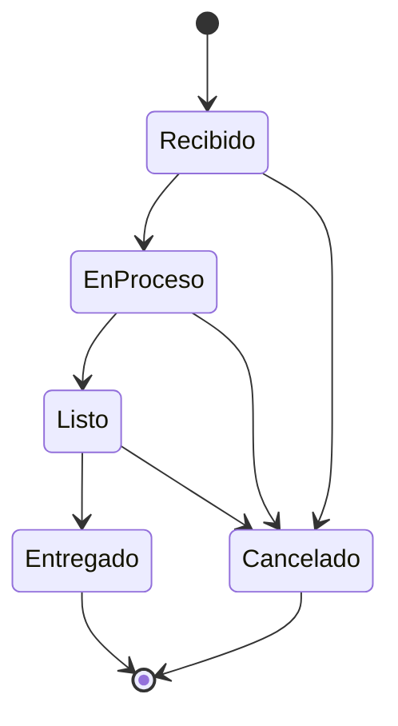

# Módulo Servicio Técnico — Orden de Trabajo

Documentación de los cambios introducidos para desarrollar por completo el módulo de
**servicio técnico**, correspondiente al caso de uso **CU14 (Gestionar servicio)** y al
requisito funcional **RF16 (Gestionar servicio técnico)** del proyecto de grado.

El módulo sigue registrándose como **venta de servicio** (relación 1:1 `servicios` → `ventas`,
tipo `servicio`), tal como exige el requisito, pero deja de ser un CRUD plano: ahora es una
**orden de trabajo** con ciclo de vida, repuestos que consumen inventario, costos, garantía,
historial e impresión.

## 1. Alcance funcional

| Antes (CRUD) | Ahora (orden de trabajo) |
|---|---|
| Un formulario que creaba/actualizaba la orden y cambiaba el estado | Alta, **edición de datos** y **cambio de estado** son flujos separados |
| Estado = selector libre de 4 opciones | Máquina de estados con transiciones y precondiciones |
| `costo` único | `mano_de_obra + Σ repuestos − descuento`, sincronizado con la venta |
| Sin repuestos | Repuestos que **descuentan inventario real** de la sucursal del taller |
| Sin trazabilidad | Historial (timeline) de cada cambio de estado |
| Sin impresión | Orden de trabajo imprimible con firmas |

## 2. Modelo de datos

Migración: `database/migrations/2026_10_16_000001_servicio_tecnico_orden_trabajo.php`.

**`servicios` (columnas añadidas)**

| Columna | Tipo | Descripción |
|---|---|---|
| `numero` | string, único | Correlativo de la orden: `OT-000001` |
| `fecha_recepcion` | date | Fecha de recepción del equipo |
| `fecha_prometida` | date, null | Fecha prometida al cliente |
| `fecha_entrega` | date, null | Se fija al pasar a `Entregado` |
| `prioridad` | string(20) | `baja` / `normal` / `alta` / `urgente` |
| `accesorios_recibidos` | text, null | Cargador, mouse, funda, etc. |
| `mano_de_obra` | decimal(12,2) | Costo del trabajo |
| `descuento` | decimal(12,2) | Descuento aplicado al total |
| `garantia_dias` | unsigned int | Días de garantía del trabajo |
| `observaciones` | text, null | Notas internas |

**`servicio_historial`** — timeline de la orden: `servicio_id`, `user_id`, `estado_anterior`,
`estado_nuevo`, `comentario`, timestamps.

**`servicio_repuestos`** — repuestos usados: `servicio_id`, `producto_id`, `cantidad`,
`precio_unitario`, `subtotal`.

## 3. Máquina de estados

Estados: `Recibido`, `EnProceso`, `Listo`, `Entregado`, `Cancelado`
(enum `App\Enums\EstadoServicio`).



Reglas de transición (`EstadoServicio::puedeTransicionarA()`):

- Solo se avanza a un estado **adyacente** de la ruta; no se puede saltar (p. ej. `Recibido → Entregado`).
- No se puede pasar a **Listo** sin **diagnóstico** registrado.
- Al pasar a **Entregado** se fija `fecha_entrega`.
- Al pasar a **Cancelado** se **devuelven al inventario** todos los repuestos de la orden.
- `Entregado` y `Cancelado` son estados finales: no admiten más cambios de estado ni de repuestos.

Cada transición queda registrada en `servicio_historial` con usuario, fecha y comentario.

## 4. Reglas de negocio

1. **Repuestos consumen inventario.** Agregar un repuesto descuenta la cantidad del stock de la
   **sucursal del taller** usando `StockService` (kardex con tipo `consumo_servicio`). Si no hay
   stock suficiente, la operación falla y **no cambia nada** (transacción). Quitar un repuesto
   devuelve la existencia (`devolucion_servicio`).
2. **Total sincronizado.** `total = mano_de_obra + Σ repuestos − descuento` (nunca negativo). Se
   refleja en `ventas.total` y en el ítem de la venta de servicio.
3. **Edición desacoplada del estado.** El formulario de edición solo modifica datos; el estado se
   cambia desde la ficha de la orden mediante transiciones validadas.
4. **Permisos.** Se respeta el permiso `servicios` y el aislamiento por sucursal: un usuario no
   gerente solo opera órdenes de su sucursal.
5. **Órdenes cerradas solo las gestiona el Gerente.** Una orden en estado final (`Entregado` o
   `Cancelado`) **no puede editarse ni eliminarse** por ningún rol que no sea **Gerente**. Un
   técnico —o cualquier rol personalizado, aunque tenga el permiso `servicios`— recibe **403**, y
   la interfaz le oculta los botones de editar/eliminar. El chequeo se apoya en `User::esGerente()`
   (rol de sistema), y ningún rol creado por el usuario puede ser de sistema (`RolController`
   fuerza `es_sistema = false`), por lo que la restricción es exclusiva del Gerente.
6. **Asignación de técnico.** El gerente puede asignar el técnico al crear la orden; por defecto
   es el usuario que la registra.

## 5. Rutas y endpoints

| Método | Ruta | Nombre | Acción |
|---|---|---|---|
| GET | `/servicios` | `servicios.index` | Listado con filtros y conteos |
| GET | `/servicios/create` | `servicios.create` | Alta |
| POST | `/servicios` | `servicios.store` | Crea la orden (venta de servicio) |
| GET | `/servicios/{servicio}` | `servicios.show` | Ficha con timeline y repuestos |
| GET | `/servicios/{servicio}/edit` | `servicios.edit` | Edición de datos |
| PUT | `/servicios/{servicio}` | `servicios.update` | Guarda datos y recalcula total |
| DELETE | `/servicios/{servicio}` | `servicios.destroy` | Elimina la orden (y su venta) |
| PATCH | `/servicios/{servicio}/estado` | `servicios.estado` | **Cambio de estado** validado |
| POST | `/servicios/{servicio}/repuestos` | `servicios.repuestos.store` | Agrega repuesto |
| DELETE | `/servicios/{servicio}/repuestos/{repuesto}` | `servicios.repuestos.destroy` | Quita repuesto |
| GET | `/servicios/{servicio}/imprimir` | `servicios.imprimir` | Orden de trabajo imprimible |

Todas bajo el middleware `permiso:servicios`.

## 6. Interfaz

- **Índice**: filtros por búsqueda (N.º de orden, equipo o cliente), prioridad, sucursal (gerente),
  rango de fechas y "solo mis órdenes"; chips de conteo por estado; alerta visual de **fechas
  prometidas vencidas**.
- **Ficha (`show`)**: estado + barra de transiciones, repuestos (con stock disponible de la
  sucursal), costos y timeline.
- **Formulario (`form`)**: alta enriquecida (cliente nuevo/registrado, sucursal, técnico, equipo,
  diagnóstico, accesorios, programación, costo y garantía) y edición de datos **sin** selector de
  estado.
- **Impresión (`imprimir`)**: orden de trabajo en hoja con datos de la empresa, cliente, equipo,
  repuestos, totales y firmas de técnico y cliente.

## 7. Pruebas

`tests/Feature/ServicioTecnicoTest.php` cubre:

- Creación de la orden: venta de servicio, número `OT-######` e historial inicial.
- Transiciones válidas avanzan y dejan historial.
- Transición inválida (`Recibido → Entregado`) rechazada.
- No se marca **Listo** sin diagnóstico.
- Agregar repuesto consume inventario y suma al total.
- Repuesto sin stock: no cambia nada (rollback).
- Quitar repuesto devuelve inventario y recalcula.
- Cancelar devuelve los repuestos al inventario.
- Orden final no admite repuestos.
- Impresión responde 200.
- Permisos por sucursal y por rol.
- Solo el Gerente edita o elimina órdenes cerradas; un rol personalizado con permiso de servicios
  tampoco puede, y el técnico sí puede gestionar órdenes abiertas.

Además se ajustaron `FormulariosTest` y `PantallasTest` al nuevo contrato.

## 8. Cómo ejecutar

```sh
php artisan migrate
php artisan test --compact
vendor/bin/pint --format agent
npm run build
```
